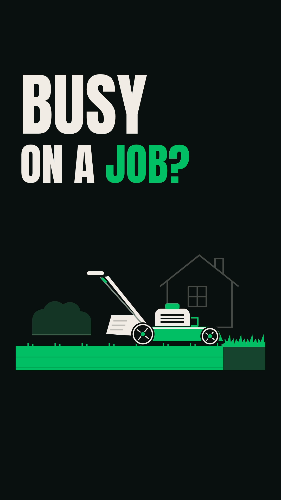
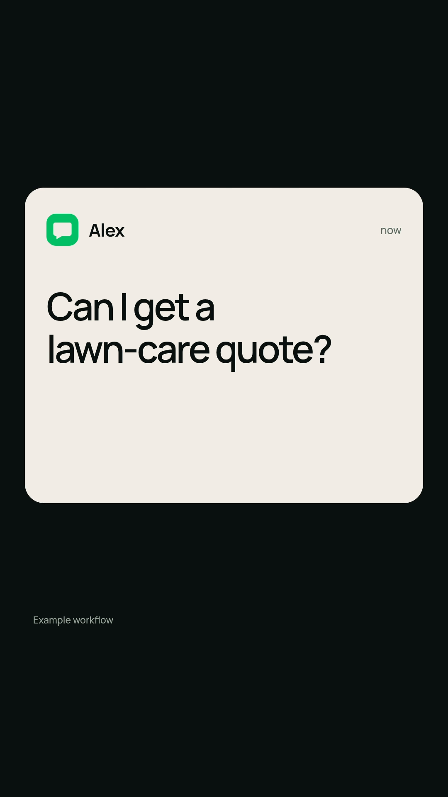
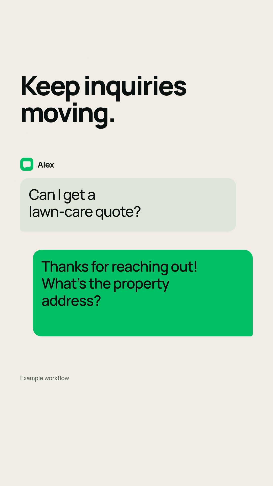

# VividScales — revised 5-second opening

[Download the MP4](VividScales-Opening-v2.mp4)

**1080×1920 · 30 fps · 150 frames · 5.000 seconds**

This revision covers the opening only. The remaining 25 seconds have not been rebuilt. The original 30-second ad is preserved as [version 1](https://github.com/angrybirdsosa56/vividscales-videos/tree/vividscales-ad-v1), including its exact source and export.

## Three representative frames

### 1.00s — huge hook and side-view landscaping

### 2.40s — customer notification

### 4.40s — conversation and reply

The three PNGs are extracted from the actual final MP4. No miniature dashboard, overhead mower or recurring fades. The same inquiry remains visible through the expanding notification-to-conversation transition.

[Editable source](../../src/compositions/vividscales-opening-v2/) · [Production notes](../../docs/vividscales-opening-v2/README.md)

Preview with `npm run dev` and select `VividScalesOpeningV2`. Render with `bash scripts/render-opening-v2.sh`. Includes restrained original SFX, no voiceover. Live speaker audition is unavailable; audio levels and encoding are measured numerically.
